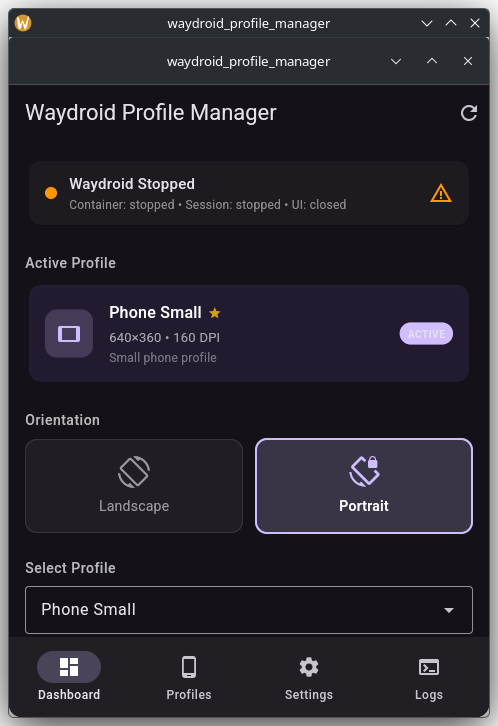
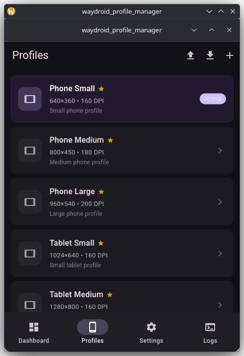
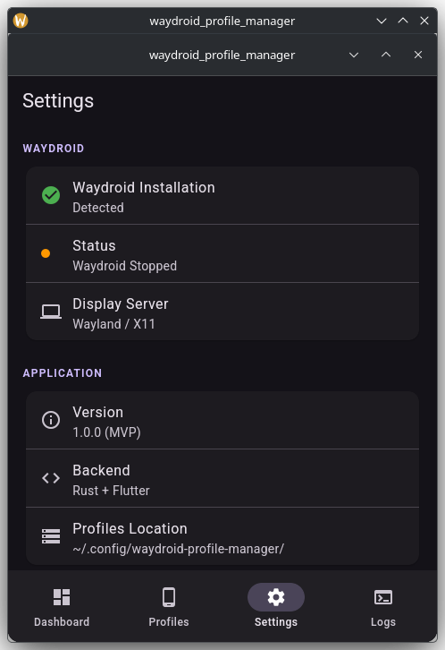
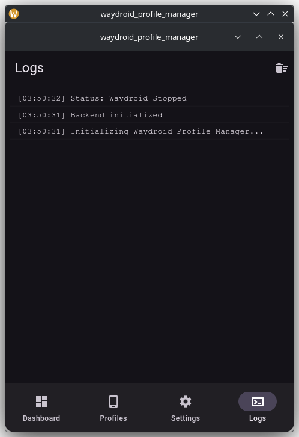

# Waydroid Profile Manager

Desktop application for Linux that manages device profiles for **Waydroid**, the Android compatibility layer. It allows resizing the Waydroid screen to custom dimensions — something Waydroid does not support natively.

## Screenshots

| Dashboard | Profiles |
|-----------|----------|
|  |  |

| Settings | Logs |
|----------|------|
|  |  |

## The Problem

Waydroid runs Android apps on Linux, but it **does not allow resizing its screen window** to arbitrary dimensions. The default fixed resolution forces users to deal with:

- Android apps that don't fit the screen properly
- No way to switch between phone and tablet layouts
- No way to test different screen densities
- Manual editing of Waydroid config files and restarting sessions

## The Solution

Waydroid Profile Manager provides a GUI to create, manage, and apply **device profiles** — predefined sets of screen dimensions (width, height, DPI density, and orientation) that change how the Android environment appears on screen.

### How It Works

1. **Select a profile** (e.g., Phone Small 720x1280, Tablet Large 1600x2560, or a custom one)
2. **Click Apply** — the app configures Waydroid properties, restarts the session, and applies the new resolution
3. The Android environment restarts with the new screen dimensions

The app uses `waydroid prop set` to configure the window size before restarting the session, and `wm size`/`wm density` inside the Android container to set the internal display resolution after the session is running.

> **Technical detail:** `waydroid prop set` only works when the session is running — props are saved to the config file and read by the next session on startup.

## Features

### Profile Management
- **6 built-in profiles**: Phone Small/Medium/Large, Tablet Small/Medium/Large
- **Custom profiles**: Create, edit, delete, and duplicate your own
- **Import/Export**: Share profiles as JSON via clipboard
- Profile fields: name, description, width, height, DPI density, default orientation

### Apply & Reset
- Apply profile with step-by-step progress indicator (11-step flow)
- Reset configuration to previous state with one click
- Automatic backup and restore of rotation settings

### Orientation
- Switch between **Landscape** and **Portrait** modes
- Dimensions automatically swap based on orientation

### System Tray
- System tray icon with quick-access menu
- Apply any profile directly from the tray (with orientation submenu)
- Real-time status updates

### Dashboard
- Waydroid status indicator (installed, container, session, UI)
- Active profile display
- Quick-select chips for fast profile switching

### Logs
- Timestamped, color-coded log viewer
- Keeps last 200 entries

## Tech Stack

| Layer | Technology |
|-------|-----------|
| Frontend | Flutter (Material Design 3, dark theme) |
| Backend | Rust (compiled to shared library via FFI) |
| State | Provider (ChangeNotifier) |
| System | System tray, GTK3 |
| FFI | Hand-written Dart FFI bindings (no codegen) |

## Project Structure

```
├── lib/                          # Flutter/Dart code
│   ├── domain/                   # Entities, enums
│   ├── application/              # Controllers (state management)
│   ├── infrastructure/           # FFI bridge to Rust
│   └── presentation/             # Screens, widgets, dialogs, tray
│
├── rust/                         # Rust backend
│   └── src/
│       ├── domain/               # Profile, validation, calculator
│       ├── application/          # Apply, reset, status, CRUD
│       └── infrastructure/       # CLI, storage, process runner
│
├── linux/                        # GTK3 runner
└── assets/                       # App icon, tray icon
```

## Requirements

- Linux (Wayland or X11)
- [Waydroid](https://waydro.id/) installed and working
- Flutter SDK >= 3.12.2
- Rust toolchain
- GTK3 development libraries

## Build & Run

### 1. Build the Rust backend

```bash
cd rust
cargo build            # debug
cargo build --release  # optimized
```

### 2. Run the Flutter app

```bash
flutter pub get
flutter run -d linux
```

The app looks for the Rust shared library in `rust/target/debug/` or `rust/target/release/`. If not found, it falls back to a mock mode with simulated data.

### 3. Run Rust tests

```bash
cd rust
cargo test
```

## Sudo Configuration

Some Waydroid commands require elevated privileges. Configure passwordless sudo for the `waydroid shell` command:

```bash
# /etc/sudoers.d/waydroid
username ALL=(ALL) NOPASSWD: /usr/bin/waydroid shell
```

## Data Storage

Profiles and app state are stored at:

```
~/.config/waydroid-profile-manager/
├── profiles.json    # All profiles (built-in + custom)
└── state.json       # Active profile ID + rotation backup
```

## Known Limitations

- Session restart takes ~30-60 seconds (Android service initialization)
- 8-second settle time after stopping session (GPU crash handling)
- Shell commands may retry up to 3 times (Android settings provider startup delay)
